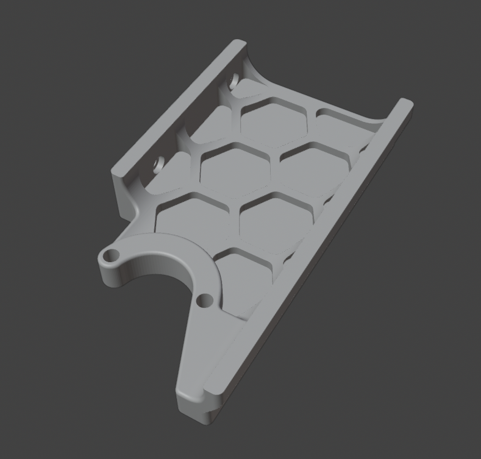

## Rear Skirt for Voron 2.4 without keystone holes

If you don't want keystone's holes in the rear skirt for Voron 2.4 

<table align=center>
  <tr>
    <td align=center>Concept</td>
    <td align=center>Parts</td>
    <td align=center>In Place</td>
    <td align=center>Out Place</td>
  </tr>
  <tr>
    <td align=center></td>
  </tr>
</table>